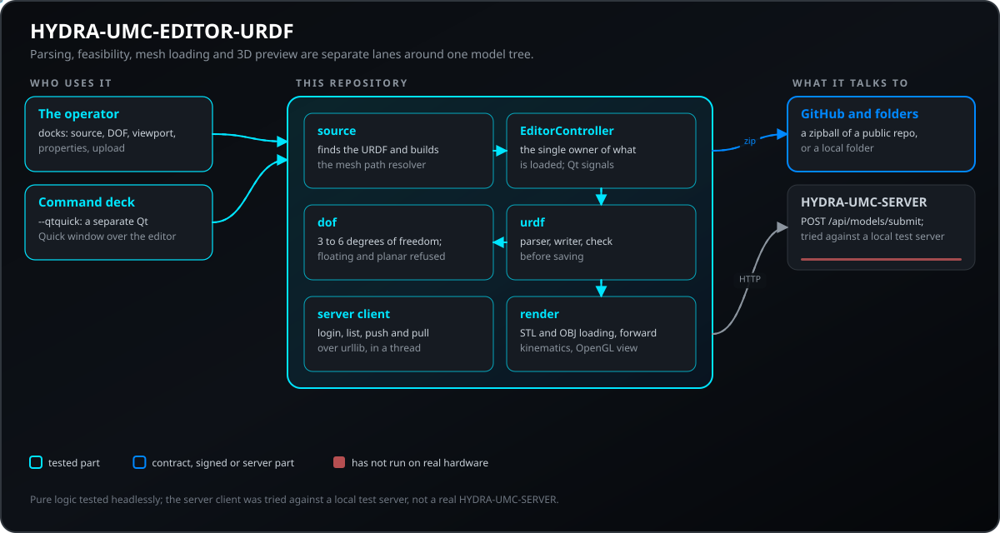
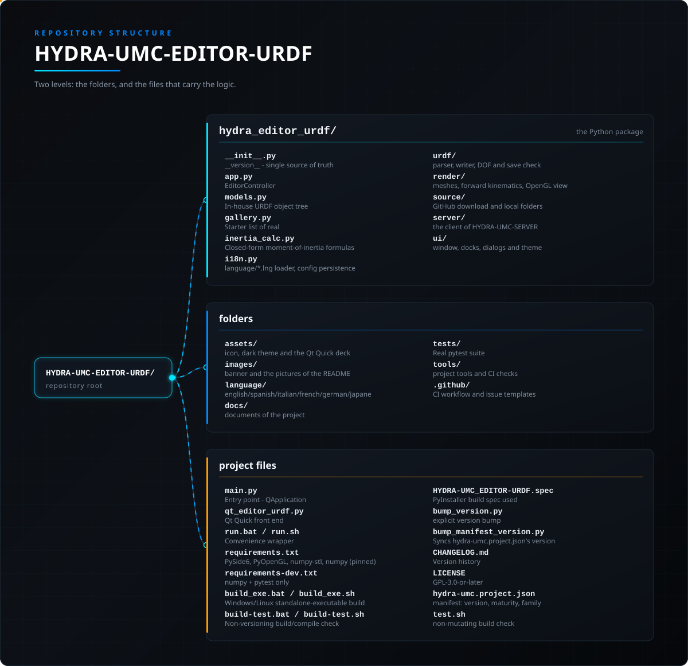

<!-- =============================================================================
HYDRA-UMC-EDITOR-URDF - Desktop URDF creator and editor for the model catalogue of HYDRA-UMC-STUDIO
Copyright (C) JuanenRac (Electro Hobby 3D) <electrohobby3d@gmail.com>
GPL-3.0-or-later - see LICENSE
============================================================================= -->

<p align="center">
  
</p>

# 🖌️ HYDRA-UMC-EDITOR-URDF

<p align="center"><a href="README.md">🇺🇸 English</a> | <a href="README_spa.md">🇪🇸 Español</a> | <a href="README_fra.md">🇫🇷 Français</a> | <a href="README_ita.md">🇮🇹 Italiano</a> | <a href="README_deu.md">🇩🇪 Deutsch</a> | 🇨🇳 <b>简体中文</b> | <a href="README_jpn.md">🇯🇵 日本語</a> | <a href="README_por.md">🇵🇹 Português</a></p>

### 🖌️ 面向 HYDRA-UMC-STUDIO 模型目录的图形化 URDF 创建/编辑工具

<p align="center">
  
  
  
  
  
  
  
</p>

---

---

**诚实核查 - 今天真正能运行的部分：** 纯逻辑核心 - URDF 解析/导出(`urdf/parser.py`、`urdf/writer.py`)、DOF 可行性验证(`urdf/dof.py`)、正向运动学(`render/kinematics.py`)、惯量估算(`inertia_calc.py`)、网格引用解析与 GitHub 压缩包下载(`source/scan.py`、`source/github_fetcher.py`、`source/local_folder.py`)、内存中的模型(`models.py`)、画廊列表(`gallery.py`)以及 i18n 加载器(`i18n.py`)——都是真实的，并由 399 个通过的测试(`tests/`)覆盖，其中没有一个测试导入 PySide6/PyOpenGL。`test_github_fetcher.py` 模拟了所有网络调用——真实的 GitHub 压缩包下载曾手动运行过，但从未纳入自动化测试套件。Qt/OpenGL 层(`render/viewport.py` 中的 `UrdfGLRenderer`、`render/mesh.py`、每一个 `ui/*` 面板，以及 `--qtquick` 面板的 `OffscreenUrdfRenderer`)是真实可运行的代码，但完全没有自动化测试覆盖——它需要真实的显示设备/Qt 平台插件，而 CI 环境没有，因此只能手动验证，而非通过测试套件验证。`server/client.py` 中的 `StudioClient`(针对 HYDRA-UMC-SERVER 的 `server.ts` 进行登录/推送/拉取)是真实的 HTTP 代码，已针对遵守 `server.ts` 契约的小型本地服务器进行测试(每次调用携带令牌、名称冲突、模型下载、恶意响应)。xacro 展开和 COLLADA(`.dae`)网格加载是明确声明、有名有姓的未实现功能(会给出清晰的错误，而不是静默解析错误)——原因见下方概述中的诚实说明，以及 URDF 解析/网格加载各节。具体已交付的内容请见 `CHANGELOG.md`。 唯一的例外是可选项:在 `hydra_editor_urdf_config.json` 中将 `xacro_expand` 设为 true,且机器上已安装 `xacro` 工具时,xacro 文件由该工具展开(程序本身不附带任何内容)。

> **安全与安防现状:**本生态系统不是经认证的安全系统。目前尚无硬件 E-STOP 通路,没有由固件强制执行的限位或联锁,也没有经过验证的运动指令;固件映像使用 CRC-32 和 Ed25519 签名校验,发布构建会拒绝已公开的开发密钥(中继之后的工具头和扩展板仍运行 URTC 的引导程序,它们使用共享密钥的 HMAC-SHA256 而不是签名);TLS 与双向 TLS 均为可选项,默认关闭;自制电路板尚未组装或测试。在依赖此处任何说法来保障人身安全之前,请先阅读[安全基线](https://github.com/JuanenRac/HYDRA-UMC-DOCS/blob/main/docs/SECURITY_BASELINE.md)和[威胁模型](https://github.com/JuanenRac/HYDRA-UMC-DOCS/blob/main/docs/THREAT_MODEL.md)。

---

## 📋 速览

| | |
|---|---|
| 版本 | `0.1.6` |
| 成熟度 | 成熟 |
| 测试 | 399 (`python -m pytest tests -q`) |
| 技术栈 | Python / PySide6 / Qt6 / OpenGL |
| 目标 | 使用者的电脑 |
| 真实硬件 | 不适用：这里的内容不在硬件上运行 |

**跳转：** [概述](#-概述) · [架构](#-架构) · [功能](#-功能) · [安全与防护](#-安全与防护) · [接口](#-接口) · [配置](#-配置) · [快速开始](#-快速开始) · [测试](#-测试) · [故障排除](#-故障排除) · [仓库结构](#-仓库结构) · [相关项目](#-相关项目)

## 🚦 项目状态

每一行是本仓库的一个部分，灯号表示它今天做到了哪一步。内容依据仓库能够展示的证据（测试、构建、运行），而不是计划。

🟢 已完成并验证 · 🟡 可用，有已知限制 · 🟠 部分完成或尚未验证 · 🔴 未完成或不可用

| 领域 | 状态 | 在这里的含义 |
|---|---|---|
| 软件 | 🟢 | 就其用途而言已完整且稳定；上面的诚实性检查列出了已知限制 |
| 测试 | 🟢 | 399 项自动测试，每次变更都会运行 |
| 真实硬件 | 🟢 | 不适用：这里的内容不在硬件上运行 |
| 文档 | 🟢 | 八种语言的 README，每次变更都会与清单核对 |

## 🎯 概述

**HYDRA-UMC EDITOR-URDF** 是一款桌面工具，将“把一个新机器人移植进 [HYDRA-UMC STUDIO](https://github.com/JuanenRac/HYDRA-UMC-STUDIO) 的模型目录”这件事，从一次性的、逐机器人的人工调查，变成了一套可重复的图形化工作流程。STUDIO 目录中的每一个真实机器人型号，过去都是通过同样的方式进入的：在 GitHub 上找到一个描述仓库、弄清楚其网格引用如何解析、数清其运动学链中的自由度数量、检查 STUDIO 是否真的能驱动这么多自由度，然后手动将结果放入 `public/models/`。本应用将整个流程自动化——从一个 GitHub URL 或一个已下载的本地文件夹拉取源文件，针对磁盘上的真实文件解析每一个 `<mesh filename="...">` 引用（包括 `package://` URI），根据 STUDIO 当前运动学所支持的范围验证该链条的自由度数量，通过实时 3D 预览编辑颜色/比例/关节限位/关节类型，并将完成的结果直接推送到一个正在运行的 STUDIO 服务器。

使用 **Python** 和 **PySide6/Qt6** 构建，采用与本生态系统中另一款桌面工具 [HYDRA-UMC SUITE](https://github.com/JuanenRac/HYDRA-UMC-SUITE) 中已经验证过的相同架构模式：类 Photoshop/Fusion-360 的可停靠工作区（`QDockWidget`）、一个手写的 OpenGL 3D 视口（`QOpenGLWidget` + GLSL 3.3 核心配置着色器，不使用 `glBegin`/`glEnd` 遗留路径），以及一个持有状态的中央控制器对象，每个 UI 面板都通过 Qt 信号监听它。在本生态系统的同类工具上复用这一模式——而非为其探索一套新的 UI/渲染技术栈——是一个刻意的选择，而非疏忽。

**诚实说明，与本生态系统其余文档所采用的惯例一致：** 本应用不展开 [xacro](http://wiki.ros.org/xacro) 宏，也不加载 COLLADA（`.dae`）网格。两者都是明确命名的限制（一条清晰的错误信息，而非静默的解析错误或视口中缺失的连杆），而非半成品式的尝试——具体原因见下方“URDF 解析”和“网格加载”两节。 唯一的例外是可选项:在 `hydra_editor_urdf_config.json` 中将 `xacro_expand` 设为 true,且机器上已安装 `xacro` 工具时,xacro 文件由该工具展开(程序本身不附带任何内容)。

## 🧩 在 HYDRA-UMC 中的角色

**HYDRA-UMC-EDITOR-URDF** 是桌面工具，它把向 HYDRA-UMC-STUDIO 模型目录移植新机器人这件事，从手工调查变成可重复的流程。它从 GitHub 仓库或本地文件夹加载 URDF，判断机器人是否符合 STUDIO 支持的 3 到 6 个自由度，在实时 3D 视图中显示，可对连杆改色、缩放并设置新的关节限位，然后导出 URDF 或推送到 HYDRA-UMC-SERVER。

## 🏛️ 架构

<p align="center">
  
</p>

## ✨ 功能

### 源加载——GitHub 或本地文件夹

有两种方式将本应用指向一个机器人的源文件，两者最终都进入同一条导入路径：

- **从 GitHub URL** —— 接受完整的 `https://github.com/owner/repo` URL（带或不带 `/tree/<branch>`）、SSH 风格的 `git@github.com:owner/repo.git`，或简写的 `owner/repo`。刻意**不**调用外部的 `git clone`，那会让 `git` 安装成为 Windows 和 Linux 上一个硬性的运行时依赖，而这本可以通过纯 HTTPS 下载完成：GitHub 会从 `codeload.github.com` 提供任意分支/标签/提交的 zip 压缩包，对公开仓库无需任何身份验证，因此本应用只使用标准库自身的 `urllib.request` + `zipfile`，别无其他。仅支持公开仓库——没有令牌/凭证处理，私有仓库的 zip 包会像不存在的仓库一样返回 404。
- **从本地文件夹** —— 适用于已经手动下载的仓库，或操作员正在此应用之外主动编辑的工作副本。
- **从 Gallery** —— GitHub URL 输入框上方的 "Gallery" 下拉菜单（`hydra_editor_urdf/gallery.py`）列出了一小份经人工核实的真实机器人描述仓库起始清单（ROS-Industrial 的 `universal_robot`、ROBOTIS 的 `open_manipulator`）。选择一项只会填入 URL 并显示其描述——不会自行发起下载，操作员仍需自己点击 Fetch，与手动输入 URL 一样。

无论哪种方式，本应用随后都会递归查找所选文件夹下的每一个 `*.urdf`/`*.xacro` 文件，列出全部（一个真实的机器人描述仓库通常不止一个文件——一个裸机械臂加上一个“带夹爪”变体是常见组合），并按文件大小自动选取最大的一个作为“主文件”的合理默认值——之后切换到另一个候选文件只需在源面板中双击一次，无需重新拉取。

**网格引用解析**是本生态系统过去每一次人工移植机器人时实际做的、不那么光鲜的工作：一个 URDF 的 `<mesh filename="package://some_pkg/meshes/link1.stl"/>`，一旦文件位于一个普通的下载文件夹中而非一个实时的 ROS 工作区（在那里 `package://` 通过 ROS 包索引解析），基本上就不再是一个可以直接打开的路径了。解析器依次尝试：（1）将该引用视为相对于 URDF 自身文件夹的路径，（2）去掉开头 `package://` 风格包名片段后的同一引用，（3）如果它本身恰好已经是绝对路径，则作为绝对路径处理，以及（4）在源文件夹下任意位置按纯文件名匹配——这才是真正处理一个真实 `package://` URI 的方式，因为该 scheme 和包名在实时 ROS 工作区之外毫无意义，但网格自身的文件名依然是可以找到的。

### 自由度可行性验证

这是本生态系统过去每一次为 STUDIO 目录添加机器人时都要手动做出的同一个判断的自动化版本：**STUDIO 自身的运动学目前支持 3、4、5 和 6 自由度的串联链**（其 `RobotState.joints` 是一个固定的 `j1..j6` 映射）——过去调研过的一些真实、许可证清晰的候选机械臂,最终被发现是 7、8 或 9 自由度,正是因为这个原因被放弃的,而不是假设性的。每次导入时（以及每次可能改变自由度数量的实时编辑之后——例如重新指定某个关节的类型），本应用都会遍历实际的父/子关节图并报告：

- **自由度数量** —— 只有 `revolute`/`continuous`/`prismatic` 关节才计为一个真正的、可控的自由度;`fixed` 不贡献任何自由度。
- **不受支持的关节类型** —— 链条中任意位置的一个 `floating` 或 `planar` 关节都会使整个机器人不可行,无论自由度数量如何,因为 STUDIO 的关节模型对这两者都没有表示方式。
- **树结构完整性** —— 要求恰好有一个根连杆（一棵真正的树,而非森林或环）;任何无法通过关节链从根连杆到达的连杆都会被标记为断开连接,任何完全没有关节引用的连杆则被标记为孤立。
- **缺失 `<limit>`** —— URDF 规范要求除 `continuous` 关节外的所有关节都必须有此项;缺失时会逐关节标记。

判定结果及背后的每一条原因都会实时呈现在自由度面板中，上传面板会拒绝将一个不可行的机器人推送到服务器。

### 带真实 3D 预览的实时编辑

属性面板会编辑视口面板连杆树中当前选中的连杆，每一次编辑都会就地修改已加载的模型，并通过一个信号（`EditorController.notify_tree_changed`）重新验证/重新渲染——没有任何面板需要知道视口或自由度报告是如何响应自己那次编辑的：

- **重新着色** —— 通过标准颜色对话框选择的连杆视觉材质。一个按名称在多个连杆间共享的材质（一个真实 URDF 顶层的 `<material name="...">` 声明被多个 `<visual>` 引用）会一起重新着色所有共享它的连杆，与该共享材质语法在规范中的真实含义一致。
- **重新缩放** —— 对网格几何体自身的 `<mesh scale="...">` 变换按轴（X/Y/Z）应用缩放因子，而非破坏性地重写网格的三角面数据本身——同一次编辑之后再次应用时，每次都从原始未修改的网格开始。
- **重新指定关节类型与限位** —— 更改一个关节的类型（URDF 规范定义的 6 种之一）及其上/下限，自由度面板的判定会立即更新，因为重新指定类型可能改变自由度数量或引入不受支持的类型。
- **质量与惯量** —— "Auto-calculate" 使用 `inertia_calc.py` 中均匀密度的闭式公式，根据所选连杆自身的几何体填入质量/Ixx/Iyy/Izz（对 Box/Cylinder/Sphere 精确，对 Mesh 则是包围盒近似值）；手动输入的质量始终优先于基于密度的估算，若尚未输入质量，则假定为通用铝密度（2700 kg/m³）并在提示中说明。"Apply" 将这些字段提交到 `Link.inertial`——与上面 Scale/Joint 相同的“先计算后应用”两步模式。

**视口面板**托管着真正的 OpenGL 3D 视图，以及每个可移动关节对应的一个点动滑块，让操作员可以在触碰 STUDIO 之前，预览 URDF 在其自身真实范围内的运动。正向运动学（`render/kinematics.py`）对刚刚导入的任意树都是通用的——与 HYDRA-UMC SUITE 自身的运动学模块（驱动一个固定的、包含数十个已知、经手工验证的机器人型号的注册表）不同，本应用必须为一个任意的、此前从未见过的 URDF 摆姿，因此它通过遍历实际的父/子关节图，组合每个关节的真实 `<origin>`/`<axis>`（对任意旋转轴使用罗德里格斯旋转公式，而不仅仅是固定注册表可以依赖的基本方向捷径）。

**Z 轴朝上，而非 Y 轴朝上**——与 HYDRA-UMC SUITE 自身视口惯例的唯一刻意差异：URDF 本身就是一种 Z 轴朝上的格式（重力方向是 `-Z`，源文件中的每一个 `<origin>`/`<axis>` 都是基于此假设编写的），本应用的任务是忠实地按其自身惯例显示和编辑一个 URDF，而不是将其重新定向到某个下游查看器（STUDIO 的 Three.js 场景、SUITE 自身的 OpenGL 场景）碰巧偏好的方向。

### 网格加载

`.stl`（通过 `numpy-stl`）和 `.obj`（一个小型的手写 Wavefront 加载器——仅支持 `v`/`vn`/`f`，n 边形面被三角化）都是一等公民。**不支持 COLLADA（`.dae`）**——它是一种更为庞大的 XML 场景图格式（骨骼动画、多重坐标系、内嵌材质/纹理），若要诚实处理，需要一个真正的解析器，而非对某个“简单”`.dae` 恰好使用的标签进行尽力猜测；引用了此类文件的连杆会得到一条清晰的、具名的错误提示，而不是在视口中静默缺失或使整个导入崩溃。每一个已加载的网格也会应用与 HYDRA-UMC STUDIO 自身的 `useRealScaleSTL()` 和 HYDRA-UMC SUITE 自身网格加载器相同的防御性毫米/米判断：任意轴上大于 5 个真实世界米的连杆，更可能是一个没有单位元数据的毫米级导出文件，而不是一个真正的巨型机器人零件，会自动按 0.001 重新缩放。

---

网格路径受到限制：`<mesh filename>` 只会解析到已打开文件夹、URDF 所在文件夹或通过"Locate Missing Meshes"添加的文件夹内的 `.stl`、`.obj` 或 `.dae` 文件；指向其他位置的 `..` 段、绝对路径和 `file://` URI 会被忽略，也只有这些文件会被上传。空的、被截断的或格式错误的网格会被报告为未加载，而不会让查看器停止工作。毫米到米的保护会在应用 URDF 的 `scale` 之前缩小任何大于 5 个单位的网格，因此已被 URDF 缩放过的网格可能被缩小两次。编辑器未建模的标签（`<dynamics>`、`<safety_controller>`、`<mimic>`、`<transmission>`、`<gazebo>`、材质纹理）在重新导出 URDF 时不会保留。

### URDF 解析与导出

通过标准库自身的 `xml.etree.ElementTree` 进行纯 XML 处理——对于这样一种简单的格式，不需要 `lxml` 依赖。内存中的模型（`hydra_editor_urdf/models.py`）是一棵刻意保持简单、可变、自研的数据类树，而非对现有 Python URDF 库（如 `urdfpy` 或 `yourdfpy`）的包装：本应用需要以交互方式*编辑*这棵树并实时重新渲染每一次更改，这不是一个以只读解析为主的库所擅长的场景，完全拥有这个模型能让它保持小巧、可检查，且不受第三方依赖自身发布节奏的影响。字段名称和默认值紧密遵循真实的 [URDF XML 规范](http://wiki.ros.org/urdf/XML)，因此解析器/写入器这一对始终是一个薄而直观的 XML↔对象映射。

**xacro 不会被展开。** [xacro](http://wiki.ros.org/xacro) 是一个拥有自己 ROS 包和依赖链的 Python/XML 宏预处理器，一个真实的 xacro 文件只有在它编写时所针对的那个 ROS 包环境内部才能被可靠地解析（宏参数、`$(find pkg)` 风格的引入等）——这是本应用无法诚实复现的。使用了 `<xacro:...>` 标签或声明了 xacro 命名空间的文件会得到一条清晰的错误信息，解释这一限制并指向 ROS 的 `xacro` 命令行工具进行预处理，而不是静默解析错误。 唯一的例外是可选项:在 `hydra_editor_urdf_config.json` 中将 `xacro_expand` 设为 true,且机器上已安装 `xacro` 工具时,xacro 文件由该工具展开(程序本身不附带任何内容)。

**可选的检查与导出,默认全部关闭**(开关在 `hydra_editor_urdf_config.json` 中):`self_collision_check` 以警告形式列出在初始姿态或逐个关节活动时包围盒重叠的连杆对(`self_collision_steps`、`self_collision_tolerance_m`;包围盒包住真实形状,因此可能报告擦边情况,但不会漏掉重叠);`license_check` 对文件夹中没有 LICENSE、COPYING、NOTICE 或 ATTRIBUTION 文件的网格以及带条件的许可证发出警告,并可根据找到的内容生成 ATTRIBUTION 文本;导出窗口有一个 Y 轴向上复选框,可为 Three.js 场景写出模型(根连杆将世界旋转四分之一圈,`y_up_scale` 缩放长度)。未开启时,它们都不会改变可行性或写出的内容。

导出（`urdf/writer.py`）会从头重新序列化当前的内存树，而非修补原始的源 XML 文本，因此每一次实时编辑——无论由哪个面板做出——都会通过同一条代码路径，恰好一次地反映在“导出 URDF”菜单操作和发送到 STUDIO 服务器的负载中。

模型没有对应字段的元素(`<transmission>`、`<gazebo>`、关节的 `<dynamics>`、`<safety_controller>` 和 `<calibration>`，以及 `<mimic>` 的倍率和偏移)在读取文件时会以文本形式保留。**导出**按钮会打开一个窗口，说明文件中有多少这样的元素，并带有一个开关，用来按源文件原样写回；开关默认关闭，每载入一个机器人就重新关闭。指向已删除关节或连杆的元素绝不会被写回。

### 可停靠工作区

真正的 `QDockWidget` 面板——拖动使其浮动、拖回停靠、合并为标签页、拆分工作区——与 HYDRA-UMC SUITE 自身主窗口已经采用的机制和理由相同：Qt 自身的停靠系统已经完全实现了类 Photoshop/Fusion-360 工作区所需的功能，一个手写实现只会带来更多的 bug 而重新发明它。5 个面板，以一种合理的默认布局排列，之后可以完全重新排列：

- **来源**——GitHub URL / 本地文件夹输入，找到的 `.urdf` 列表。
- **自由度**——可行性判定及其背后的每一条原因。
- **视口**——实时 3D 视图、连杆树、点动滑块。
- **属性**——针对所选连杆的重新着色/重新缩放/重新指定类型与限位。
- **上传**——连接到 STUDIO 服务器，推送或拉取。

### 服务器往返

使用标准库自身的 `urllib.request` 与 HYDRA-UMC-SERVER 自身的模型提交契约通信（该项目自身 `server.ts` 中的 `POST /api/models/submit`、`GET /api/models`、`GET /api/models/:category/:slug/download`，受其自身的 **Config > Models > "Accept model submissions"** 开关控制）——为一个只需要 4 个端点、而非一条持久实时连接的项目引入 `httpx`/`requests` 不值得。每次调用都在后台 `QThread` 上运行，因此一个缓慢或不可达的服务器永远不会冻结 UI。这个契约曾经存在于 HYDRA-UMC-STUDIO 自身进程内部，后来该项目拆分为一个纯前端（STUDIO）加一个独立的无头式后端（HYDRA-UMC-SERVER，见下方“相关项目”）——本应用不硬编码任何一个名字，操作员只需将**上传**面板的主机/端口字段指向真实后端实际运行的位置即可。

- **登录** —— `POST /api/login`；只有 `admin` 角色的令牌才能实际到达服务端的 `POST /api/models/submit`，因此本应用实际上只能配合管理员账户使用，与其他每一个仅限管理员的 STUDIO 功能一样。
- **推送** —— 将当前机器人重新序列化为 URDF XML，并将其视觉部分引用的每一个网格文件（通过导入时构建的同一个网格解析器解析）以 base64 编码内联到请求体中，并标记上操作员选择的类别（对应 STUDIO 自身 Config > UI > Module Visibility 的类别：Robot 3-6DOF、CNC、Pick & Place、Laser、Vacuum Table、XY Table、Heated Bed、ATC Tools——一个 URDF 本身没有任何字段能说明它属于其中哪一类）。名称冲突会以服务器自身的 409 响应返回；由操作员决定是勾选**覆盖**重新提交还是重命名，本应用从不自行猜测。
- **拉取** —— 将一个已提交模型的 URDF + 网格重新下载到本地工作文件夹，并直接加载进编辑器中——这是本应用自身用途的“提取、编辑、重新发送”往返流程的另一半，让一个已存在的目录条目可以在无需重新回到其原始源仓库的情况下进行修饰。

### 多语言界面

界面在**英语、西班牙语、意大利语、法语、德语、简体中文、日语和葡萄牙语**（`language/*.lng`）之间全面翻译，使用与本生态系统中每一个其他 Python 工具（URTC Flasher、URTC Tester、HYDRA-UMC SUITE）完全相同的纯 `KEY=Value` 文件机制——此处并未重新发明，因为该机制本身不带有任何项目特定的逻辑。语言切换在应用重启后生效，而非实时重新翻译每一个已构建的控件，遵循同样的惯例。`language/` 位于可执行文件**旁边**，而非通过 PyInstaller 的 `--add-data` 打包进其内部，因此翻译者无需重新构建即可编辑或添加一个 `.lng` 文件。

### 主题

可停靠工作区顶部工具栏是一个真正的 `QToolBar`/`QLabel`/`QToolButton` 命令控制台，
而不是独立的 Qt Quick/QML 界面——早期通过 QQuickWidget 嵌入的版本（与
HYDRA-UMC-UPDATER 和 HYDRA-UMC-SUITE 相同的渲染引擎）一旦放入这个
`QMainWindow` 真正的 `QDockWidget` 布局中，就会渲染成一整块黑色、且控制台没有
任何报错，因此被还原为普通控件；完整经过见 `CHANGELOG.md`。Source、DOF、
Viewport、Properties 和 Upload 按钮只会显示既有停靠面板；Export 与 About 复用
既有操作，且 Export 在模型真正加载之前保持禁用。加载 URDF 后（以及每次实时属性
编辑后），其状态标签会显示已加载模型的名称、DOF 数量和当前可行性判定结果。
它不替代 OpenGL 视口、编辑器、解析器或服务器上传实现。

原样复用 HYDRA-UMC SUITE 自身的 `assets/qss/industrial_dark.qss`（相同的相对路径，相同的文件），而不是为本生态系统中的同类桌面工具设计一套新的视觉主题。

### 可视化命令控制台（`--qtquick`）

那次嵌入尝试与这个应用现在拥有的真正 Qt Quick 命令控制台是完全不同、彼此独立的两回事：

~~~
python main.py --qtquick
~~~

一个完全独立的 QML `ApplicationWindow`（`qt_editor_urdf.py` + `assets/qml/EditorDeck.qml`），从未嵌入经典的 `QMainWindow` 中——与 HYDRA-UMC-OS-REBUILDER、HYDRA-UMC-UPDATER、URTC-TESTER、URTC-FLASHER 和 HYDRA-UMC-SUITE 已经使用的、经过验证的同一种模式一致，与经典入口点并行启动，而不是取代它。它忠实还原了经典可停靠工作区的真实空间布局（左侧 Source 和 DOF 以标签页形式呈现，Viewport 和 Properties 并排，Upload 横跨底部）以及其 5 个面板的每一项真实功能——从 GitHub/图库/本地文件夹加载、实时 DOF 校验、带可点击链接树和每关节点动滑块的可旋转/平移/缩放 3D 预览、颜色/缩放/关节限位/质量与惯量编辑，以及与 STUDIO 服务器之间真正的连接/推送/拉取往返——全部通过同一个 `EditorController`，没有任何一项被重复实现。3D 预览通过一个专用的 `OffscreenUrdfRenderer` 复用经典视口自身真实的渲染代码（`render/viewport.py` 的 `UrdfGLRenderer`），采用与 HYDRA-UMC-SUITE 自身 Qt Quick Viewport 面板相同的真实 `QOpenGLContext`/`QOffscreenSurface`/帧缓冲方案，通过 `QQuickImageProvider` 传入 QML。

## 🔒 安全与防护

| 威胁 | 防御 | 位置 |
|---|---|---|
| 跳出文件夹的网格路径 | `<mesh filename>` 只会解析为已打开文件夹、URDF 所在文件夹或通过“定位缺失网格”添加的文件夹内的 `.stl`、`.obj` 或 `.dae` 文件；指向别处的 `..`、绝对路径和 `file://` URI 会被忽略，上传的也只有这些文件 | `source/scan.py`, `render/mesh.py` |
| 损坏、为空或恶意的网格或 URDF 文件 | 空的、被截断的或格式错误的网格会被报告为未加载，而不会使查看器停止；非 UTF-8 或二进制的文件、格式错误的文本以及连杆树中的循环会被拒绝并给出提示；大于 5 个单位的网格会被当作毫米重新缩放一次 | `render/mesh.py`, `urdf/parser.py`, `tests/test_edge_cases.py` |
| 卡住或并非来自 GitHub 的下载 | 只会获取符合 GitHub URL 模式的地址，以 zipball 形式下载，每个请求限时 20 秒，且不调用 `git`；适用 GitHub 自身每个地址每小时 60 次请求的限制 | `source/github_fetcher.py` |
| STUDIO 无法运行的机器人，或带有不可能数值的已保存模型 | 可行性检查接受 3 到 6 个自由度，并拒绝浮动关节和平面关节、孤立连杆、断开或有多个父节点的树；保存前会运行检查（关节限位、质量），导出时会保留备份 | `urdf/dof.py`, `urdf/save_check.py` |
| 向未要求的服务器推送模型 | 由服务器决定：必须开启“接受模型提交”（Config > Models），并且账户必须是管理员；每次调用限时 15 秒，在后台线程中运行；已存在的名称在勾选“覆盖”之前会被拒绝 | `server/client.py` |

**它绝不做的事：** 连接机器人、移动机器人，或对导出的 URDF 向下游使用者作出任何保证。使用该文件的人必须自行检查。

## 🔌 接口

| 主题或路由 | 内容 |
|---|---|
| URDF file or folder / GitHub address | 打开的对象：磁盘上的文件夹，或以 zip 下载的公开 GitHub 仓库；`.xacro` 文件会被拒绝并给出说明，`.dae` 网格会被标明为不支持 |
| URDF export | 整棵树由 `urdf/writer.py` 从模型重新写出，因此每次编辑在文件中恰好出现一次；被覆盖的文件会先备份 |
| `POST /api/login` | 登录；只有 `admin` 令牌能到达提交路由，客户端也能适应连列出模型都要求登录的服务器 |
| `POST /api/models/submit`, `GET /api/models`, `GET /api/models/:category/:slug/download` | 连同内嵌网格推送 URDF、列出目录，并把已提交的模型拉回本地工作文件夹 |

## ⚙️ 配置

只有一个小配置文件和固定的依赖项；不会从环境中读取其他内容。

| 变量 | 默认值 | 设置内容 |
|---|---|---|
| `hydra_editor_urdf_config.json` | `{"language": ...}` | 窗口的语言，是 `language/` 中八个 `.lng` 文件之一；该文件位于程序旁边 |
| `requirements.txt` | 固定 | numpy 2.5.2、numpy-stl 4.0.0、PyOpenGL 3.1.10 和 PySide6 6.11.1 |
| `MIN_SUPPORTED_DOF`, `MAX_SUPPORTED_DOF` | 3, 6 | STUDIO 能运行的自由度，位于 `urdf/dof.py`；STUDIO 改变时在那里修改 |

## 🚀 快速开始

需要 Python 3.11 或更高版本以及支持 OpenGL 3.3 的显卡驱动。依赖包在 `requirements.txt` 中固定，不需要安装 `git`：GitHub 源以 zip 形式下载。

```bash
pip install -r requirements.txt  # installs PySide6, PyOpenGL, numpy and numpy-stl at the pinned versions
python main.py                   # starts the editor (run.bat or run.sh do the same inside a .venv when there is one)
python main.py --qtquick         # the separate Qt Quick command deck
python -m pytest tests -q        # runs the tests (pip install -r requirements-dev.txt first)
```

### 系统要求
- [Python](https://www.python.org/) 3.11 或更高版本
- pip

### 安装

```bash
pip install -r requirements.txt
```

这会拉取已锁定版本的依赖集：**PySide6**（Qt6 界面）、**PyOpenGL**（3D 视口渲染）、**numpy** / **numpy-stl**（网格数学与 STL 加载）。无需安装 `git`——GitHub 源加载路径通过 HTTPS 下载一个纯粹的 zip 压缩包。

### 开发模式

```bash
python main.py
```

或者使用便捷脚本——`run.bat`（Windows）/ `run.sh`（Linux/Mac），若旁边存在 `.venv` 则会激活它，并将参数转发给 `main.py`；双击运行时两者都不会自行关闭终端窗口。

以最大化方式启动（并非真正的操作系统级全屏，因此原生窗口标题栏和控件保持可见）——按 **F11** 切换真正的无边框全屏及返回。

## 🧪 测试

运行 `python -m pytest tests -q` 会执行 399 个自动测试。 不需要硬件，也不需要这台机器以外的任何东西。

CI 运行 `HYDRA_UMC_CI=1 python tools/ci_validate.py`，检查清单、文档、八个 README 和图片。

### 自动化测试

```bash
pip install -r requirements-dev.txt
python -m pytest tests/ -q
```

说明:本应用自身的纯逻辑(URDF 解析/导出、DOF 可行性校验、正向运动学、惯性估算、网格引用解析、GitHub 拉取、i18n)此前完全没有自动化测试覆盖。已修复:新增 15 个测试模块共 399 个真实测试,其中没有一个会导入 PySide6/PyOpenGL——`requirements-dev.txt` 只安装 `tests/` 真正需要的东西(`numpy` 和 `pytest`),因此整个测试套件无需显示器或 Qt 平台插件即可运行。其中几个测试是针对此前已发现并修复、且已在源码本身留有注释记录的 bug 的明确回归测试(`render/kinematics.py` 中针对真实环路的无限循环防护、`source/scan.py` 的 `had_scheme` 条件、`urdf/dof.py` 的负质量检查)——今后的修改如果悄悄让其中任何一个问题重现,都会被测试直接拦下。CI(`.github/workflows/ci.yml`)在每次推送时都会运行同样的命令。

## 🏗️ 构建与发布

### 生产构建

通过 PyInstaller 编译一个独立的可执行文件（运行它无需安装 Python）：

- **Windows：** 运行 `build_exe.bat` → 生成 `dist\HYDRA-UMC_EDITOR-URDF.exe`
- **Linux：** 运行 `./build_exe.sh`（首次需先 `chmod +x build_exe.sh`）→ 生成 `dist/HYDRA-UMC_EDITOR-URDF`

两个脚本都会创建自己的 `.venv`，安装 `requirements.txt` 加上 `pyinstaller`，清理任何先前的 `build`/`dist`，编译，最后将 `README.md`、`LICENSE` 以及整个 `language/` 文件夹复制到生成的二进制文件旁边（`language/` 刻意**不**通过 `--add-data` 打包进可执行文件内部，因此之后可以编辑或添加一个 `.lng` 文件而无需重新构建）。

如果你更愿意手动执行等效步骤而非使用脚本——这对于在脚本未覆盖的平台上适配构建，或调试某个 PyInstaller 标志很有用——手动流程如下：

```bash
# 1. 创建并激活虚拟环境
python -m venv .venv
# Windows: .venv\Scripts\activate.bat   |   Linux/Mac: source .venv/bin/activate

# 2. 安装依赖 + PyInstaller
pip install -r requirements.txt
pip install pyinstaller

# 3. 定位 PySide6 自身的安装目录（其 Qt 插件位于其下）
python -c "import PySide6, os; print(os.path.dirname(PySide6.__file__))"
# -> 即下方的 $PYSIDE_DIR

# 4. 编译——仅显式暂存了 4 个 Qt 插件子文件夹
#    （platforms/styles/imageformats/iconengines），而非
#    --collect-all PySide6，那样会拉入 Qt6WebEngineCore.dll 及其他
#    数百 MB 级、本应用从未使用过的组件。PyInstaller 自身的依赖分析器
#    通过跟随 main.py 的真实导入图找到实际的 Qt6Core/Gui/Widgets/OpenGL
#    DLL——只有插件文件夹需要手动添加。
#
#    Windows（插件直接位于 PySide6/plugins/ 下）：
pyinstaller --onefile --windowed --noconfirm --name "HYDRA-UMC_EDITOR-URDF" \
    --add-data "assets;assets" \
    --add-data "%PYSIDE_DIR%\plugins\platforms;PySide6\plugins\platforms" \
    --add-data "%PYSIDE_DIR%\plugins\styles;PySide6\plugins\styles" \
    --add-data "%PYSIDE_DIR%\plugins\imageformats;PySide6\plugins\imageformats" \
    --add-data "%PYSIDE_DIR%\plugins\iconengines;PySide6\plugins\iconengines" \
    --hidden-import PySide6.QtOpenGL --hidden-import PySide6.QtOpenGLWidgets \
    --hidden-import OpenGL.platform.win32 \
    main.py

#    Linux（插件位于 PySide6/Qt/plugins/ 下——与 Windows 不同的布局，
#    通过阅读 PyInstaller 自身的运行时钩子 pyi_rth_pyside6.py 确认）：
pyinstaller --onefile --noconfirm --name "HYDRA-UMC_EDITOR-URDF" \
    --add-data "assets:assets" \
    --add-data "$PYSIDE_DIR/Qt/plugins/platforms:PySide6/Qt/plugins/platforms" \
    --add-data "$PYSIDE_DIR/Qt/plugins/styles:PySide6/Qt/plugins/styles" \
    --add-data "$PYSIDE_DIR/Qt/plugins/imageformats:PySide6/Qt/plugins/imageformats" \
    --add-data "$PYSIDE_DIR/Qt/plugins/iconengines:PySide6/Qt/plugins/iconengines" \
    --hidden-import PySide6.QtOpenGL --hidden-import PySide6.QtOpenGLWidgets \
    main.py

# 5. 复制必须位于二进制文件旁边、而非其内部的文件
cp README.md LICENSE dist/
cp -r language dist/language
```

在 Linux 上，运行编译好的二进制文件需要系统自身的 OpenGL 运行时（`libGL.so.1`——例如 Debian/Ubuntu 上的 `libgl1`、Fedora 上的 `mesa-libGL`、Arch 上的 `libglvnd`），加上 Qt 自身 XCB 平台插件所需的 `libxkbcommon-x11-0`/`xcb-util-cursor`；`build_exe.sh` 会预先检查 `libGL.so.1`，如果缺失会为每个发行版打印正确的安装命令，而不是让失败深藏在一次 PyInstaller 运行内部。

## 🩺 故障排除

| 你看到 | 原因 | 处理 |
|---|---|---|
| 提到 xacro 的错误，或视图中缺少连杆 | 文件使用了不会被展开的 `<xacro:...>` 宏，或连杆指向不会被加载的 `.dae` 网格 | 先用 ROS 的 `xacro` 工具展开 xacro，并把网格导出为 `.stl` 或 `.obj` |
| 打开仓库后连杆没有网格 | 网格路径在已打开的文件夹内无法解析，或网格为空或格式错误 | 使用“定位缺失网格”添加包含它们的文件夹 |
| DOF 面板提示机器人不可行 | 机器人的自由度少于 3 或多于 6，有浮动或平面关节、孤立连杆，或树断开或有多个父节点 | 阅读判定下列出的原因，并在“属性”面板中编辑关节类型和限位 |
| 推送被拒绝：409、401，或“不接受提交” | 名称已存在（409）、账户不是管理员或会话已失效（401），或服务器关闭了“接受模型提交” | 勾选“覆盖”以替换，以管理员身份登录，或在服务器的 Config > Models 中开启提交 |

## 📂 仓库结构

<p align="center">
  
</p>

<details>
<summary>目录树的文本版本</summary>

```text
HYDRA-UMC-EDITOR-URDF/
├── hydra_editor_urdf/
│   ├── __init__.py                  __version__ —— 唯一权威来源，由 About 对话框读取，由 bump_version.py 重写
│   ├── app.py                       EditorController —— “当前加载了什么”的唯一持有者，每个面板监听的 Qt 信号
│   ├── models.py                    自研的 URDF 对象树（Robot/Link/Joint/Visual/Geometry/Material/…）
│   ├── gallery.py                   经过验证的真实公开机器人描述仓库的初始列表
│   ├── inertia_calc.py              基本几何体的闭式转动惯量公式
│   ├── i18n.py                      language/*.lng 加载器、配置持久化——从 HYDRA-UMC-SUITE 自身的 i18n.py 移植
│   ├── urdf/                        解析器、写出器、DOF 和保存检查
│   ├── render/                      网格、正向运动学、OpenGL 视图
│   ├── source/                      GitHub 下载和本地文件夹
│   ├── server/                      HYDRA-UMC-SERVER 的客户端
│   └── ui/                          窗口、停靠面板、对话框和主题
├── assets/                          图标、深色主题和 Qt Quick 面板
├── images/                          横幅和 README 的图片
├── language/                        english/spanish/italian/french/german/chinese/japanese/portuguese.lng —— 位于 exe 旁边，未打包
├── docs/                            项目文档
├── tests/                           真实的 pytest 套件(355 个测试)——只测纯逻辑,这里完全没有导入 PySide6
├── tools/                           项目工具和 CI 检查
├── .github/                         CI 工作流和 Issue 模板
├── main.py                          入口点——QApplication、主题、最大化启动、F11 全屏切换；--qtquick 切换到下方面板
├── qt_editor_urdf.py                Qt Quick 前端 —— 独立的 `--qtquick` 命令面板，将未改动的 EditorController 接入 QML
├── run.bat / run.sh                 便捷启动脚本——若存在 .venv 则激活，运行 main.py，不会自行关闭窗口
├── requirements.txt                 PySide6、PyOpenGL、numpy-stl、numpy（已锁定版本）
├── requirements-dev.txt             仅 numpy + pytest——tests/ 真正需要的东西,不含 PySide6
├── build_exe.bat / build_exe.sh     Windows/Linux 独立可执行文件构建脚本（PyInstaller）——先递增版本号
├── build-test.bat / build-test.sh   不递增版本号的构建/编译检查
├── HYDRA-UMC_EDITOR-URDF.spec       build_exe.bat/.sh 使用的 PyInstaller 构建规格
├── bump_version.py                  显式提升版本
├── bump_manifest_version.py         将 hydra-umc.project.json 的版本与原生版本同步（--sync）
├── CHANGELOG.md                     版本历史
├── LICENSE                          GPL-3.0-or-later
├── hydra-umc.project.json           清单：版本、成熟度、系列
└── test.sh                          不修改内容的构建检查
```

</details>

## 🗺️ 路线图与已知限制

xacro 宏不会被展开，COLLADA（`.dae`）网格不会被加载；两者都会给出明确的错误。机器人必须符合 3 到 6 个自由度才会被 STUDIO 接受。与服务器的往返只在本地测试服务器上试过，没有在真实的 HYDRA-UMC-SERVER 上试过。Qt Quick 命令面板是单独的 `--qtquick` 窗口，不属于可停靠的工作区。

## 🌍 语言

本 README 和仓库文档提供八种语言：英语、西班牙语、德语、法语、意大利语、日语、中文和葡萄牙语（葡萄牙）。它们同时编写，并由 CI 检查八个文件拥有相同的章节和相同的链接。

## 🔗 相关项目

本项目是同一作者（JuanenRac / Electro Hobby 3D）打造的 HYDRA-UMC 机器人生态系统的一部分。值得了解，因为某个请求实际上可能与这些项目有关，而不是这个仓库本身。

**父项目**
- **[HYDRA-UMC-STUDIO](https://github.com/JuanenRac/HYDRA-UMC-STUDIO)** —— 本编辑器存在的目的正是为其填充的模型目录；完成的结果通过 `POST /api/models/submit` 直接推送到正在运行的 STUDIO 服务器。

**直接相关**
- **[HYDRA-UMC-EDITOR-STL](https://github.com/JuanenRac/HYDRA-UMC-EDITOR-STL)** —— 姐妹桌面编辑器，负责同一模型目录中原始 STL 几何体，而非本工具编辑的 URDF/运动学一侧。
- **[HYDRA-UMC-SERVER](https://github.com/JuanenRac/HYDRA-UMC-SERVER)** —— 拥有本编辑器推送完成模型所用的真实 `POST /api/models/submit` 端点。
- **[HYDRA-UMC-TWIN](https://github.com/JuanenRac/HYDRA-UMC-TWIN)** —— 使用此处创建的 URDF 模型来驱动其物理仿真。
- **[HYDRA-UMC-PHYSICS-REPLICA](https://github.com/JuanenRac/HYDRA-UMC-PHYSICS-REPLICA)** —— 使用此处创建的 URDF 模型来驱动其物理仿真。
- **[HYDRA-UMC-SYNTHETIC-DATA-GEN](https://github.com/JuanenRac/HYDRA-UMC-SYNTHETIC-DATA-GEN)** —— 根据此处创建的模型生成训练数据。

**同样属于生态系统的项目**

*核心硬件与平台*
- **[HYDRA-UMC-OS](https://github.com/JuanenRac/HYDRA-UMC-OS)** — 面向 CM5 的可复现 Raspberry Pi OS 产品层：只读代理、经过验证的配置/配置文件、WiFi 首次配网。
- **[HYDRA-UMC-SDK](https://github.com/JuanenRac/HYDRA-UMC-SDK)** — 每个桥接都据此校验自身指令的共享 JSON-Schema 契约与软件作业门限边界(并非经认证的安全功能)。
- **[HYDRA-UMC-CONNECTOR-HUB](https://github.com/JuanenRac/HYDRA-UMC-CONNECTOR-HUB)** — 面向外部机器连接器的声明式适配器清单注册与校验工具；把 SDK 自身的契约理念扩展到外部机器，而不取代工业网关类项目。

*核心后端与客户端*
- **[HYDRA-UMC](https://github.com/JuanenRac/HYDRA-UMC)** — 机器人手臂主板设计——CM5 主机 + 双核 STM32H745,目标是通过 CAN-OTA/SPI-OTA 协调最多 8 条工具臂(固件处于早期阶段,尚无已组装的电路板)。
- **[HYDRA-UMC-SUITE](https://github.com/JuanenRac/HYDRA-UMC-SUITE)** — 可同时管理多台服务器的桌面（PySide6）集群指挥中心。
- **[HYDRA-UMC-ANDROID-CONTROL](https://github.com/JuanenRac/HYDRA-UMC-ANDROID-CONTROL)** — 带生物识别登录和配对 Wear OS 伴侣应用的原生 Android 控制应用。
- **[HYDRA-UMC-IOS-CONTROL](https://github.com/JuanenRac/HYDRA-UMC-IOS-CONTROL)** — 带实时 WebSocket 同步的 iOS/iPadOS 控制应用（Flutter）。
- **[HYDRA-UMC-DSI](https://github.com/JuanenRac/HYDRA-UMC-DSI)** — CM5 自身搭载的 7 英寸 DSI 触摸屏的原生触控界面。
- **[HYDRA-UMC-BRIDGE-AMR](https://github.com/JuanenRac/HYDRA-UMC-BRIDGE-AMR)** — 通过 VDA 5050 MQTT 发布者为 AGV/AMR 车队提供的协调边界(仅针对仿真车队测试)。
- **[HYDRA-UMC-BRIDGE-CNC](https://github.com/JuanenRac/HYDRA-UMC-BRIDGE-CNC)** — 具备 GRBL 状态/控制字节访问能力的高层 CNC 单元协调器(仅针对模拟器测试)。
- **[HYDRA-UMC-BRIDGE-DROIDS](https://github.com/JuanenRac/HYDRA-UMC-BRIDGE-DROIDS)** — 面向足式/人形机器人的协调边界,带有 Boston Dynamics Spot 指令发送器(仅针对模拟器测试)。
- **[HYDRA-UMC-BRIDGE-LASER](https://github.com/JuanenRac/HYDRA-UMC-BRIDGE-LASER)** — 读取 3 路钥匙/外壳/联锁 GPIO 信号的激光单元协调器(仅针对模拟芯片测试;无法使激光器上膛或发射)。
- **[HYDRA-UMC-BRIDGE-OPENPNP](https://github.com/JuanenRac/HYDRA-UMC-BRIDGE-OPENPNP)** — 面向 OpenPnP 贴片的安全高层板流协调器。
- **[HYDRA-UMC-BRIDGE-PRINTER3D](https://github.com/JuanenRac/HYDRA-UMC-BRIDGE-PRINTER3D)** — 面向 Moonraker/Klipper 3D 打印机的安全协调边界，具备真实受控的任务命令。
- **[HYDRA-UMC-BRIDGE-ROS2](https://github.com/JuanenRac/HYDRA-UMC-BRIDGE-ROS2)** — 带有惰性导入 rclpy ROS 2 传输层的协调器(尚未在 ROS 2 环境中运行)。
- **[HYDRA-UMC-BRIDGE-UAV](https://github.com/JuanenRac/HYDRA-UMC-BRIDGE-UAV)** — 面向搭载摄像头的无人机的协调边界,带有 MAVLink 指令发送器(仅针对模拟器测试)。

*URTC 工具平台*
- **[URTC](https://github.com/JuanenRac/URTC)** — 物理 Universal Robot Tool Controller 板卡的固件，通过 CAN 总线提供 25+ 种工具配置文件。
- **[URTC-FLASHER](https://github.com/JuanenRac/URTC-FLASHER)** — 用于烧录 URTC 板卡的桌面图形工具，支持 CAN-OTA 以及完整芯片 SWD/JTAG。
- **[URTC-TESTER](https://github.com/JuanenRac/URTC-TESTER)** — 面向 URTC 板卡的桌面实时 CAN 总线诊断工具，每个工具配置文件一个面板。
- **[URTC-WEB-STUDIO](https://github.com/JuanenRac/URTC-WEB-STUDIO)** — 通过 Web Serial API 提供的浏览器版 URTC-TESTER 替代方案，无需本地安装。
- **[URTC-GATEWAY](https://github.com/JuanenRac/URTC-GATEWAY)** — URTC CAN 总线前的网关：允许的标识符列表、速率限制和会话密钥；软件已在计算机上测试，尚未在真实总线上测试。

*视觉 AI 节点（Hailo-8）*
- **[HYDRA-UMC-VISION-NODE](https://github.com/JuanenRac/HYDRA-UMC-VISION-NODE)** — Hailo-8 视觉流水线的集成中枢，具备真实的分阶段硬件就绪检查。
- **[HYDRA-UMC-DETECTION-HEF](https://github.com/JuanenRac/HYDRA-UMC-DETECTION-HEF)** — 具备 Hailo 架构/校验和安全加载验证的真实已编译模型注册表。
- **[HYDRA-UMC-VISION-STREAMER](https://github.com/JuanenRac/HYDRA-UMC-VISION-STREAMER)** — 具备真实 HailoRT 集成边界的真实 GStreamer 流水线 + MediaMTX 配置生成器。
- **[HYDRA-UMC-VISUAL-SERVOING-API](https://github.com/JuanenRac/HYDRA-UMC-VISUAL-SERVOING-API)** — 以区域状态为授权条件的 Position-Based Visual Servoing 修正律;尚无摄像头位姿估计。
- **[HYDRA-UMC-SAFETY-ZONES](https://github.com/JuanenRac/HYDRA-UMC-SAFETY-ZONES)** — 真实的区域入侵检查和急停请求，强制要求校准保持最新。

*认知 AI 节点（Hailo-10）*
- **[HYDRA-UMC-COGNITIVE-NODE](https://github.com/JuanenRac/HYDRA-UMC-COGNITIVE-NODE)** — Hailo-10 认知流水线（LLM/VLA/语音编排）的集成中枢。
- **[HYDRA-UMC-VLA-ENGINE](https://github.com/JuanenRac/HYDRA-UMC-VLA-ENGINE)** — 面向视觉-语言-行动模型的真实动作令牌编解码与轨迹生成。
- **[HYDRA-UMC-VOICE-UI](https://github.com/JuanenRac/HYDRA-UMC-VOICE-UI)** — 具备受限、需确认的 Watch 中继功能的真实语音前端（VAD + 意图解析器）。
- **[HYDRA-UMC-SEMANTIC-PLANNER](https://github.com/JuanenRac/HYDRA-UMC-SEMANTIC-PLANNER)** — 针对 MCU 错误代码的真实基于规则的任务分解与语义错误恢复。
- **[HYDRA-UMC-DOCS-QA](https://github.com/JuanenRac/HYDRA-UMC-DOCS-QA)** — 针对本生态系统自身 Markdown 文档的真实纯标准库 TF-IDF 文档搜索。
- **[HYDRA-UMC-LOCAL-TECHNICIAN](https://github.com/JuanenRac/HYDRA-UMC-LOCAL-TECHNICIAN)** — 面向生态系统自身的本地、按策略门控的 AI 维护技师——观察、诊断并提出修复建议;两个最高风险等级目前特意尚未实现。

*编排与集群*
- **[HYDRA-UMC-ORCHESTRATOR](https://github.com/JuanenRac/HYDRA-UMC-ORCHESTRATOR)** — 具备真实 gRPC/Protobuf 健康报告契约和任务状态机的集成中枢。
- **[HYDRA-UMC-JOB-DISPATCHER](https://github.com/JuanenRac/HYDRA-UMC-JOB-DISPATCHER)** — 基于真实 HTTP API、具备去重功能的真实优先级任务队列。
- **[HYDRA-UMC-NODE-HEALING](https://github.com/JuanenRac/HYDRA-UMC-NODE-HEALING)** — 基于 gRPC、具备重试/退避和身份不匹配检测的真实集群健康看门狗。
- **[HYDRA-UMC-PATH-PLANNER-3D](https://github.com/JuanenRac/HYDRA-UMC-PATH-PLANNER-3D)** — 具备真实障碍物/工作空间碰撞校验的真实基于 RRT 的 3D 路径规划器。
- **[HYDRA-UMC-SWARM-SYNC](https://github.com/JuanenRac/HYDRA-UMC-SWARM-SYNC)** — 经过属性测试以验证多单元收敛的真实 CRDT LWW-Element-Map 状态同步。

*数字孪生与仿真*
- **[HYDRA-UMC-HIL-BRIDGE](https://github.com/JuanenRac/HYDRA-UMC-HIL-BRIDGE)** — 在仿真与真实硬件之间带有软件碰撞联锁的硬件在环路由器(未在真实硬件上测试)。

*数据与分析*
- **[HYDRA-UMC-DATALAKE](https://github.com/JuanenRac/HYDRA-UMC-DATALAKE)** — 基于 sqlite3、具备真实摄取/查询 HTTP API 的真实时间序列存储。
- **[HYDRA-UMC-ANOMALY-DETECTOR](https://github.com/JuanenRac/HYDRA-UMC-ANOMALY-DETECTOR)** — 具备漂移监测的真实 FFT + 统计基线异常检测器。
- **[HYDRA-UMC-PRODUCTION-REPORTS](https://github.com/JuanenRac/HYDRA-UMC-PRODUCTION-REPORTS)** — 基于 DATALAKE 历史数据、具备可复现 CSV 导出的真实 OEE/可用性计算。
- **[HYDRA-UMC-TELEMETRY-COLLECTOR](https://github.com/JuanenRac/HYDRA-UMC-TELEMETRY-COLLECTOR)** — 具备序列去重的真实 CAN/WebSocket 摄取流水线，写入 DATALAKE。

*工业网关*
- **[HYDRA-UMC-GATEWAY-INDUSTRIAL](https://github.com/JuanenRac/HYDRA-UMC-GATEWAY-INDUSTRIAL)** — 转发至工业协议的集成中枢，具备真实的命令白名单/背压层。
- **[HYDRA-UMC-OPCUA-SERVER](https://github.com/JuanenRac/HYDRA-UMC-OPCUA-SERVER)** — 经过真实二进制协议客户端会话验证的真实 OPC-UA 地址空间。
- **[HYDRA-UMC-MQTT-BROKER](https://github.com/JuanenRac/HYDRA-UMC-MQTT-BROKER)** — 具备可选的按客户端认证和主题 ACL 的真实 MQTT 代理。
- **[HYDRA-UMC-MTCONNECT-ADAPTER](https://github.com/JuanenRac/HYDRA-UMC-MTCONNECT-ADAPTER)** — 具备降级模式输出的真实 MTConnect `/probe` 和 `/current` XML 端点。

*配套工具与生态系统运维*
- **[HYDRA-UMC-DASHBOARD-AI](https://github.com/JuanenRac/HYDRA-UMC-DASHBOARD-AI)** — 基于 DATALAKE/ANOMALY-DETECTOR、具备诚实统计回退机制的智能摘要与异常高亮面板。
- **[HYDRA-UMC-TOOL-CLI](https://github.com/JuanenRac/HYDRA-UMC-TOOL-CLI)** — 具备真实、稳定退出码契约的集群 CLI，是 HYDRA-UMC-SERVER 自身 API 的真实在线客户端。
- **[HYDRA-UMC-WATCH](https://github.com/JuanenRac/HYDRA-UMC-WATCH)** — 带有触觉提醒模式与配对手机语音中继的 WearOS 伴侣应用(尚未在实体手表上运行)。
- **[URTC-SMART-RACK](https://github.com/JuanenRac/URTC-SMART-RACK)** — 板卡安装机架的固件，具备真实的工具 ID 解码和 Smart Idle 预热逻辑。
- **[URTC-VISION-TOOL](https://github.com/JuanenRac/URTC-VISION-TOOL)** — 固件加上面向热成像/RGB 检测工具头的真实 Python 视觉伴侣程序。
- **[HYDRA-UMC-UPDATER](https://github.com/JuanenRac/HYDRA-UMC-UPDATER)** —— 发现、克隆并更新本生态系统中每个仓库的管理类桌面工具。
- **[HYDRA-UMC-OS-REBUILDER](https://github.com/JuanenRac/HYDRA-UMC-OS-REBUILDER)** —— 构建即刻可烧录、预装生态系统最新版本的 CM5 镜像的 Windows/Linux 桌面工具,具备类似 Raspberry Pi Imager 风格的首次启动 Wi-Fi/用户/SSH 配置。
- **[HYDRA-UMC-OPS-AGENT](https://github.com/JuanenRac/HYDRA-UMC-OPS-AGENT)** — 维护事件协调器：一个低权限的边缘角色采集经过脱敏的库存/健康快照，一个控制面角色以只读方式渲染它，并请求某个 AI 提供方给出诊断建议——从不应用补丁，也从不部署任何内容。
- **[HYDRA-UMC-DEV-SERVER](https://github.com/JuanenRac/HYDRA-UMC-DEV-SERVER)** — 可复现的开发主机（Raspberry Pi 5 / CM5），保存整个生态系统的源代码，并在持久队列下运行有界的构建/测试任务；这是专用的开发角色，明确区别于运行中的 CM5。

## 📚 文档

更多阅读：

* [docs/SOURCE_MAP.md](docs/SOURCE_MAP.md) - 编辑器的每个源文件及一行说明
* [docs/LICENSING.md](docs/LICENSING.md) - 代码、文档和网格的许可方式
* **[docs/ARCHITECTURE.md](docs/ARCHITECTURE.md)** —— 编辑器自身的内部结构：为什么解析、可行性校验、网格解析和 3D 预览是相互独立的通路，以及本应用刻意**不**做的事情（不会自行连接机器人、上传 URDF 或下达运动指令）。
* **[docs/BUILD_AND_RUN.md](docs/BUILD_AND_RUN.md)** —— 非破坏性的 `build-test.bat`/`.sh` 校验流程与真正打包的 `build_exe.bat`/`.sh` 之间的区别，以及命令控制台如今究竟是什么（`QToolBar`，而非 Qt Quick/QML —— 参见上方**主题**一节）。
* **[docs/INTEGRATION_CONTRACT.md](docs/INTEGRATION_CONTRACT.md)** —— 下游消费一个已导出 URDF 文件的一方必须自行校验的内容；本项目自身不提供任何网络端点或硬件控制权限。
* [生态系统的安全基线](https://github.com/JuanenRac/HYDRA-UMC-DOCS/blob/main/docs/SECURITY_BASELINE.md)
* [生态系统的威胁模型](https://github.com/JuanenRac/HYDRA-UMC-DOCS/blob/main/docs/THREAT_MODEL.md)
* [本仓库的更新日志](CHANGELOG.md)
* [本仓库的许可证](LICENSE.md)

## 🤝 参与贡献与社区

* 提交 pull request 之前，请运行 `HYDRA_UMC_CI=1 py -3 tools/ci_validate.py`（或 `HYDRA_UMC_CI=1 python3 tools/ci_validate.py`）：它必须输出 `CI_VALIDATION=PASS`。此检查不要运行 `build.sh` 或 `build.bat`；构建不是检查。
* 八个 README 由 HYDRA-UMC-DOCS 中的同一个源生成；请勿手工编辑。修改源文件，再用 `tools/make_readmes.py` 重新生成。
* 不要在 README 中声称尚未运行过的内容：属实时请写“仅模拟”或“尚未在硬件上试过”。
* 请参阅 [CONTRIBUTING.md](CONTRIBUTING.md)、[行为准则](CODE_OF_CONDUCT.md)、[SECURITY.md](SECURITY.md) 和 [SUPPORT.md](SUPPORT.md)。

## 👤 作者

**JuanenRac (Electro Hobby 3D)** · electrohobby3d@gmail.com

## 📜 许可证

GPL-3.0-or-later - [LICENSE](LICENSE).
